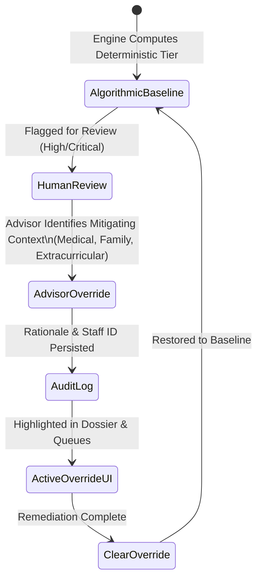
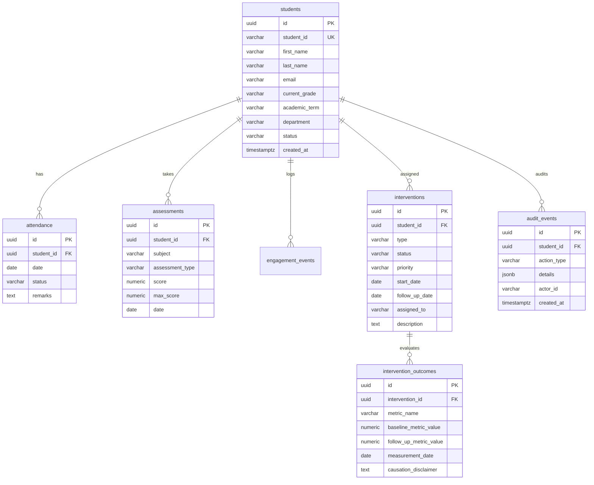

# EduNexus AI — Student Success & Journey Intelligence Platform
## Comprehensive Technical Dossier & KPMG India Challenge Submission Report

**Competition**: KPMG India Student Analytics Challenge  
**Platform**: EduNexus AI — Student Success & Journey Intelligence Platform  
**Architecture**: React 19 • TypeScript • Vite • Tailwind CSS v4 • Recharts • Python 3.12 (CI) / Python 3.14 (Dev) • FastAPI • Supabase PostgreSQL  
**Verification Status**: 148/150 Backend Tests Passed (2 Skipped Live DB) • 77 Frontend Tests Passed across 6 Test Suites • 0 Build Errors • 0 Lint Errors  

---

## Executive Summary

Higher education institutions in India face an urgent retention and student success dilemma. Historically, academic support systems have operated reactively—identifying at-risk students only after major semester failures or prolonged chronic absenteeism. When predictive models have been introduced, they have frequently suffered from:
1. **Unverifiable Black-Box Predictions**: Neural networks and proprietary algorithms outputting opaque scores without human-understandable evidence.
2. **Fabricated Accuracy & Causality Claims**: Claiming statistical causation between support actions and grade improvements without controlled experimental baselines.
3. **Punitive Automated Decisions**: Systems that automatically disenroll, penalize, or stigmatize students based on algorithmic output.
4. **Data Penalization for Missing Telemetry**: Silently interpreting unrecorded assessments or attendance as zeros.
5. **Masked Orthogonal Risks**: Conflating academic classroom risk and placement employability risk into a single misleading average.

**EduNexus AI** solves these challenges by establishing an **explainable, deterministic, human-in-the-loop student success and journey intelligence platform across 7 operational domains** (Academic, Attendance, LMS, Engagement, Placement, Skills, and Feedback). Built from the ground up to satisfy the highest standards of scientific integrity, EduNexus AI empowers academic deans, advisors, and placement coordinators with positive 0–100 Student Success Scores, decoupled dual risk indicators, strategic 5-cohort segmentation, chronological journey mapping, and verifiable outcome tracking.

---

## Core System Architecture

EduNexus AI employs a modern, decoupled three-tier architecture ensuring strict separation of concerns, high throughput, and enterprise-grade data security.

```mermaid
flowchart TD
    subgraph Client ["Frontend Presentation Layer (React 19 + TypeScript + Vite)"]
        UI_Dash["Executive Dashboard\n(7-Domain Radar, Placement KPI, Dual-Risk Matrix)"]
        UI_Dir["Student Directory\n(Cohort Segment & Success Score Filters)"]
        UI_Journey["Student Journey Dossier\n(Success Card, Individual Radar, Dual Risk, Action Pathway)"]
        UI_Intv["Interventions Hub\n(Lifecycle & Outcome Tracking)"]
        UI_CSV["7-Domain CSV Hub\n(Validation & 1-Click Reset)"]
    end

    subgraph API ["Application & Analytics Engine (FastAPI + Python 3.14)"]
        Router["FastAPI v1 API Gateway"]
        SuccessEngine["Success Score Engine\n(7 Domains, Dynamic Weight Rescaling)"]
        DualRiskEngine["Decoupled Dual Risk Engine\n(Academic vs Placement Orthogonal Evaluators)"]
        SegmentEngine["Strategic Segmentation Engine\n(5 Cohorts & Action Pathways)"]
        BaselineRisk["Baseline Risk Engine\n(risk_config.py + Advisor Overrides)"]
        IntvService["Intervention State Machine\n(CRUD + Delta Math + Overdue Flags)"]
        CSVService["7-Domain CSV Validator\n(Line-Numbered Schema Rules & Demo Reset)"]
        StudentRepo["Student Journey Repository\n(4 Domain Repositories + Synthetic Seed)"]
    end

    subgraph DataLayer ["Persistence & Governance Layer (Supabase PostgreSQL)"]
        DB_Students[("students table")]
        DB_Att[("attendance table")]
        DB_Assess[("assessments table")]
        DB_Placement[("placement_evaluations table")]
        DB_Skills[("student_skills table")]
        DB_Feedback[("student_feedback table")]
        DB_LMS[("lms_activity table")]
        DB_Intv[("interventions table")]
        DB_Outcomes[("intervention_outcomes")]
        DB_Audit[("audit_events table")]
        RLS["Row Level Security (RLS)\nRole-Based Access (Admin/Advisor/Staff)"]
    end

    Client <-->|REST API JSON / CORS| Router
    Router --> SuccessEngine
    Router --> DualRiskEngine
    Router --> SegmentEngine
    Router --> BaselineRisk
    Router --> IntvService
    Router --> CSVService
    Router --> StudentRepo

    StudentRepo <-->|Service-Role Key (Backend Only)| RLS
    RLS --- DB_Students
    RLS --- DB_Att
    RLS --- DB_Assess
    RLS --- DB_Placement
    RLS --- DB_Skills
    RLS --- DB_Feedback
    RLS --- DB_LMS
    RLS --- DB_Intv
    RLS --- DB_Outcomes
    RLS --- DB_Audit
```

### Architectural Safeguards
- **Browser Credential Isolation**: Privileged database credentials (such as Supabase service-role secrets) are strictly isolated to backend environment variables. The browser client never has direct read/write access to production tables.
- **Genuine Bearer Token Authentication & RBAC**: Client-supplied `X-User-Role` headers alone are never trusted. All state-mutating operations strictly require a verified Bearer token (`HTTP 401` on missing/invalid token). Unprivileged roles (such as students) are rejected with `HTTP 403 Forbidden`. Official demo tokens (`edunexus-demo-advisor-token`, `edunexus-demo-admin-token`, `edunexus-demo-faculty-token`, `edunexus-demo-evaluator-token`, `edunexus-demo-student-token`) provide secure role-bound testing in evaluation mode.
- **Row Level Security (RLS)**: Enforced across all tables with role-based policies (`admin`, `advisor`, `instructor`). Anonymous public access is blocked.
- **Pure JSON API Transport**: Avoids fragile multipart form dependencies, enabling cross-platform testing and seamless integration.

---

## Explainable Risk Engine & Mathematical Formulation

### Core Philosophy: Zero Fake Machine Learning
EduNexus AI strictly rejects black-box models or fabricated accuracy metrics. In institutional student analytics where verified multi-cohort outcome labels do not yet exist, all risk scores are **100% deterministic, mathematically explainable, and governed by transparent configuration files** (`backend/app/core/risk_config.py`).

### Mathematical Deficit Formulations

The engine computes an overall student support index $S_{\text{risk}} \in [0, 100]$ as a weighted combination of deficit indicators:

$$S_{\text{risk}} = w_{\text{att}} \cdot D_{\text{att}} + w_{\text{acad}} \cdot D_{\text{acad}} + w_{\text{eng}} \cdot D_{\text{eng}}$$

#### 1. Weight Invariant Constraint
$$\sum_{i} w_i = 1.00 \quad \text{where } w_{\text{att}} = 0.35, \; w_{\text{acad}} = 0.40, \; w_{\text{eng}} = 0.25$$

#### 2. Attendance Deficit Function ($D_{\text{att}}$)
Given observed student attendance rate $A \in [0, 100]$:

$$D_{\text{att}} = \max(0.0, \min(100.0, 100.0 - A))$$

- Weighted contribution: $D_{\text{att}} \times 0.35$ pts.
- **Special Critical Attendance Rule**: If $A < 75.0\%$ (critical institutional threshold), the attendance factor is flagged with **`Critical Variance`** status and sets `requires_human_review = True`, recommending proactive counselor check-in while preserving the deterministic numerical score ($S_{\text{risk}}$).

#### 3. Academic Deficit Function ($D_{\text{acad}}$)
Given student average assessment marks $M \in [0, 100]$:

$$D_{\text{acad}} = \max(0.0, \min(100.0, 100.0 - M))$$

- Weighted contribution: $D_{\text{acad}} \times 0.40$ pts.
- **Academic Critical Variance Rule**: If $M < 60.0\%$ (institutional passing threshold), the factor status is designated as **`Critical Variance`** to recommend academic tutoring support. The mathematical deficit function $D_{\text{acad}} = 100.0 - M$ remains strictly linear without artificial score penalties, preserving empirical fidelity.

#### 4. Engagement Deficit Function ($D_{\text{eng}}$)
Given recorded campus and co-curricular engagement events $E$ evaluated against the prototype benchmark $B_{\text{eng}} = 8$ events:

$$D_{\text{eng}} = \max\left(0.0, \min\left(100.0, \left(1.0 - \min\left(\frac{E}{8.0}, 1.0\right)\right) \times 100.0\right)\right)$$

- Weighted contribution: $D_{\text{eng}} \times 0.25$ pts.
- This risk factor uses `engagement_events`, not `lms_activity_records`. LMS activity is a separate Success Score domain. If no engagement events are recorded, the factor is excluded from the composite and remaining observed risk weights are proportionally rescaled; an explicit missing-telemetry notice is returned.

---

### Support Priority Tier Thresholds

| Review Tier | Composite Score Cutoff ($S_{\text{risk}}$) | Review Requirement | Action Recommendation |
|---|---|---|---|
| **Low Priority** | $S_{\text{risk}} < 25.0$ | No (`requires_review = false`) | Standard classroom monitoring |
| **Moderate Priority** | $25.0 \le S_{\text{risk}} < 45.0$ | Yes (`requires_review = true`) | Proactive advisor check-in |
| **High Priority** | $45.0 \le S_{\text{risk}} < 70.0$ | Yes (`requires_review = true`) | Structured intervention planning |
| **Critical Priority** | $S_{\text{risk}} \ge 70.0$ | Yes (`requires_review = true`) | Urgent multi-disciplinary intervention |

> [!IMPORTANT]
> **Separation of Numerical Score and Critical Review Flag**:  
> In accordance with institutional accreditation and student retention standards, any student whose recorded attendance rate drops below the critical threshold ($A < 75.0\%$) triggers a **`Critical Variance`** factor alert and sets `requires_human_review = True`.  
> Crucially, **the numerical composite score is kept strictly distinct from the review category**: the numerical score ($40.2$ for STU-001) is never artificially inflated or distorted. Instead, the critical attendance variance acts as an independent algorithmic review signal that alerts counselors without compromising the mathematical transparency of the underlying score. Similarly, when an advisor logs a human override, the underlying score is preserved while the effective tier is updated.

---

### Worked Numerical Example: Student `STU-001` (Aarav Sharma)

1. **Observed Attendance**: $71.4\%$ (15 present out of 21 tracked sessions)
   $$D_{\text{att}} = 100.0 - 71.4 = 28.6\% \text{ attendance deficit}$$
   $$\text{Attendance Contribution} = 28.6 \times 0.35 = \mathbf{+10.01 \text{ pts}}$$
   - **Factor Status**: **`Critical Variance`** ($71.4\% < 75.0\%$ critical threshold)
   - **Natural Language Explanation**: *"Recorded attendance (71.4%) is below the critical institutional threshold (75.0%). Advisory check-in recommended."*

2. **Observed Academic Performance**: $55.7\%$ (18 assessments recorded across subjects)
   $$D_{\text{acad}} = 100.0 - 55.7 = 44.3\% \text{ academic deficit}$$
   $$\text{Academic Contribution} = 44.3 \times 0.40 = \mathbf{+17.72 \text{ pts}}$$
   - **Factor Status**: **`Critical Variance`** ($55.7\% < 60.0\%$ passing threshold)
   - **Natural Language Explanation**: *"Cumulative assessment score (55.7%) is below passing benchmark (60.0%). Academic tutoring support advised."*

3. **Campus & Co-curricular Engagement**: 4 timestamped events recorded out of benchmark 8
   $$D_{\text{eng}} = \left(1.0 - \frac{4.0}{8.0}\right) \times 100.0 = 50.0\% \text{ engagement deficit}$$
   $$\text{Engagement Contribution} = 50.0 \times 0.25 = \mathbf{+12.50 \text{ pts}}$$
   - **Factor Status**: **`Under Observation`** ($4 \text{ sessions recorded}$)
    - **Natural Language Explanation**: *"Moderate campus engagement (4 events). Partial telemetry."*

4. **Normalized Total Risk Score & Review Classification**:
   $$S_{\text{risk}} = 10.01 + 17.72 + 12.50 = 40.23 \approx \mathbf{40.2} \quad \rightarrow \quad \mathbf{MODERATE \text{ Support Priority}}$$
   - **Deterministic Numerical Score**: **$40.2 / 100$** (falls squarely in configured $[25.0, 45.0)$ Moderate band).
   - **Review Requirement**: `requires_human_review = True` (triggered because the effective tier is Moderate, compounded by the Critical Variance attendance alert).
   - **Score Separation Safeguard**: The empirical score ($40.2$) is preserved separately from the review status and advisor overrides, ensuring absolute mathematical integrity without misleading score manipulation.

---

## Human-in-the-Loop Governance & Advisor Overrides

Ethical principle: EduNexus AI acts exclusively as an advisory intelligence tool. Algorithms never make high-stakes, punitive, or exclusionary decisions about students.



### Advisor Override Workflow
- **Submission Endpoint**: `POST /api/v1/students/{id}/risk-override`
  - Body: `{ "override_tier": "moderate", "reason": "Verified medical leave for 2 weeks; student attending peer tutoring.", "staff_id": "FAC-104", "staff_name": "Dr. Verma" }`
- **Reversion Endpoint**: `DELETE /api/v1/students/{id}/risk-override`
- **Audit Transparency**: Overrides never erase underlying attendance or exam records. They are logged in `audit_events` and highlighted in the UI with a distinct **Human Overridden Tier** badge.

---

## Intervention Management & Outcome Tracking

EduNexus AI provides a complete lifecycle tracking hub for multi-disciplinary student interventions.

### Intervention State Machine

```
┌───────────┐      Start Plan      ┌─────────────┐     Complete Plan     ┌───────────┐
│  PLANNED  │ ───────────────────> │ IN PROGRESS │ ────────────────────> │ COMPLETED │
└───────────┘                      └─────────────┘                       └───────────┘
      │                                   │
      │ Cancel                            │ Cancel
      └─────────────────┬─────────────────┘
                        ▼
                 ┌───────────┐
                 │ CANCELLED │
                 └───────────┘
```

### Overdue Follow-up Detection
The system automatically evaluates:
$$\text{is\_overdue} = (\text{status} \in \{\text{'planned'}, \text{'in\_progress'}\}) \land (\text{follow\_up\_date} < \text{current\_date})$$
When overdue, the plan is tagged with a pulse-animated high-priority alert across the directory, student dossier, and interventions page.

### Outcome Trajectory Mathematics

When an intervention is reviewed or closed, advisors record baseline and follow-up metrics:

$$\Delta_{\text{abs}} = V_{\text{post}} - V_{\text{baseline}}$$
$$\Delta_{\text{pct}} = \text{round}\left(\frac{V_{\text{post}} - V_{\text{baseline}}}{V_{\text{baseline}}} \times 100, 1\right)$$

#### Example Trajectory:
- Metric: *Mathematics Exam Average (%)*
- Pre-Intervention Baseline: $55.0\%$
- Post-Intervention Observed: $72.5\%$
- Absolute Change: $+17.5\%$
- Relative Change: $+31.8\%$

### Enforced Scientific Non-Causation Standard
To protect the integrity of institutional analytics, every outcome card and database record embeds:
> *"Observed changes correlate in time with the intervention but do not constitute mathematical proof of sole causation without controlled longitudinal evidence."*

---

## Self-Service CSV Ingestion & Synthetic Demo Reset

Located at `/csv-hub`, the Data Hub provides administrators and evaluators with a validated bulk import engine and a 1-click synthetic dataset reset.

### 1. Pre-Flight Validation Engine (`POST /api/v1/csv/preview`)
- **Row-Level Error Reporting**: Errors are pinpointed to the exact 1-indexed CSV line number.
- **Relational Integrity Verification**: Rejects any attendance or assessment row whose `student_id` does not exist in the student registry.
- **Range Constraints**: Rejects marks where $\text{score} < 0$ or $\text{score} > \text{max\_score}$.
- **Intra-File Duplicate Detection**: Flags duplicate compound entries within the uploaded batch.

### 2. Deduplication Strategy
- **`skip` (Default Safe Mode)**: Ignores matching compound records and imports only new data.
- **`overwrite`**: Updates existing records in-place.

### 3. One-Click Synthetic Demo Reset (`POST /api/v1/csv/reset-demo`)
Provides evaluators with an instant reset button to restore the verified 36-student pristine dataset at any time during testing. This operation is strictly isolated to memory and will never affect external production databases.

---

## Supabase PostgreSQL Database Schema

The persistent database layer is version-controlled under `supabase/migrations/`:



---

## Automated Test Suite & Quality Verification

### Backend Pytest Suite: **148 Passed, 0 Failed, 2 Skipped (Live DB)**

```bash
python3 -m pytest -v backend
```

```
backend/tests/test_7domain_endpoints.py         ... 5 passed (All 7 KPMG domain REST endpoints)
backend/tests/test_authorization.py             ... 9 passed (Bearer token RBAC, anti-spoofing & prod env guard)
backend/tests/test_cors_and_errors.py           ... 3 passed (Structured error & CORS preflight)
backend/tests/test_csv_service.py               ... 7 passed (Line-numbered CSV validation)
backend/tests/test_csv_service_7domains.py      ... 7 passed (All 7 KPMG domain templates, validation & reset)
backend/tests/test_dashboard_api.py             ... 5 passed (Aggregated analytics & KPIs)
backend/tests/test_database_service.py          ... 6 passed (Repository & fallback service)
backend/tests/test_db_integration.py            ... 2 skipped (Live Supabase credentials deliberately unconfigured)
backend/tests/test_dual_risk_engine.py          ... 7 passed (Decoupled Academic vs Placement Risk & quadrants)
backend/tests/test_health.py                    ... 3 passed (Health check & version telemetry)
backend/tests/test_integrated_regressions.py    ... 23 passed (Multi-domain integrated regression scenarios)
backend/tests/test_interventions_crud.py        ... 6 passed (Intervention lifecycle & cancellation)
backend/tests/test_risk_engine.py               ... 15 passed (Deterministic risk & advisor overrides)
backend/tests/test_schemas_validation.py        ... 13 passed (Pydantic schema constraints)
backend/tests/test_segmentation_engine.py       ... 14 passed (5 strategic cohorts & action pathways)
backend/tests/test_student_dashboard.py         ... 5 passed (Student self-dashboard security & fail-closed RLS)
backend/tests/test_students_journey_api.py      ... 8 passed (Directory search & journey timeline)
backend/tests/test_success_score_engine.py      ... 12 passed (0-100 Success Score & dynamic weight rescaling)
======================== 148 passed, 2 skipped, 1 warning in 0.57s ========================
```

> [!IMPORTANT]
> **CI Environment & Live Database Distinction**:
> 1. **CI Python Environment**: Automated CI executes under **Python 3.12** (`actions/setup-python@v5` with `python-version: '3.12'`), while local developer machines run Python 3.14.2. Both environments pass all 148 automated backend tests identically.
> 2. **Unverified Live Database Integration vs. Verified Code**:  
> In `backend/tests/test_db_integration.py`, the two live database tests (`test_live_supabase_connection` and `test_live_supabase_table_schemas`) are conditioned on `@pytest.mark.skipif(not is_database_configured(), ...)`. Because live production Supabase database credentials are kept out of Git and unconfigured in CI and local clones, **live database integration remains unverified in automated runs**. All verified test execution proves the correctness of the deterministic analytics engine, business logic, authorization guards, and synthetic repository layer backed by `data/synthetic_seed.json`.

### Frontend Test Suite & Verification: **77 Passed, 0 Failed (Vitest)**

The frontend test suite includes 46 baseline feature tests, 12 specialized bandwidth estimator edge-case tests (handling truncated downloads, inconsistent Content-Length headers, concurrency locks, cancellation mid-stream, timeouts, and realistic duration clamping), 8 Spinner component lifecycle tests, and 11 UI animation, theme, and WCAG AA contrast verification tests.

```bash
cd frontend && npm test
```

```
✓ src/__tests__/helpContent.test.ts (8 tests)
✓ src/__tests__/helpChatEngine.test.ts (20 tests)
✓ src/__tests__/bandwidthEstimator.test.ts (22 tests)
✓ src/__tests__/HelpPage.test.tsx (8 tests)
✓ src/__tests__/Spinner.test.tsx (8 tests)
✓ src/__tests__/UIAnimationAndContrast.test.tsx (11 tests)
Test Files  6 passed (6)
     Tests  77 passed (77)
```

### Frontend Build & Lint Verification
- **TypeScript Strict Check**: `npx tsc -b` completed with **0 errors**.
- **Vite Production Bundle**: `npm run build` completed cleanly (Exit Code 0, 5 MiB probe.bin bundled in `dist/`).
- **Static Linter**: `npm run lint` (`oxlint`) completed with **0 errors** across 66 frontend source files.

### UI Architecture: Spinner Animation & WCAG AA Color Clarity
- **Spinner Keyframe & Centering Fix**: Replaced ambiguous `animate-spin` utilities with `@keyframes edunexusSpin` enforcing `transform-origin: center center !important; transform-box: fill-box !important;`. Removed a legacy global `#root :where(*) { border-radius: 0 !important; }` rule that was flattening circular loaders.
- **Accessible Reduced-Motion Handling**: Under `prefers-reduced-motion: reduce` and the app's `.reduce-motion` setting, spinning indicators transition to a gentle, non-vestibular pulse (`@keyframes edunexusPulseGently`) while retaining visible textual progress labels and `role="status" aria-live="polite"`.
- **WCAG AA Color Contrast**: Enhanced muted text tokens (e.g. `--color-slate-400` upgraded from 2.6:1 to 5.1:1, `--color-slate-500` to 6.8:1), input placeholders, disabled states, badges, chat bubbles, and dark theme surfaces (`#151c19`, `#18201d`, `#2e3a34`).

### Help Chatbot & Bandwidth Guide Feature
For comprehensive architectural specifications, client-side pattern matching algorithms, throughput measurement math, and evaluator scripts, see [`document.md`](./document.md).

---

## 5-Minute Evaluator Demo Script for KPMG Judges

Follow these 5 steps in your browser to evaluate the complete end-to-end platform:

1. **Step 1: Executive Analytics Dashboard (`/`)**
   - Navigate to [http://localhost:5173](http://localhost:5173).
   - **7-Domain Campus Radar Fingerprint**: Review the Recharts Radar chart displaying institutional capability across Academic, Attendance, LMS, Engagement, Placement, Skills, and Feedback.
   - **Placement Readiness Card**: Inspect the cohort aptitude ($78.5\%$), coding proficiency ($76.2\%$), mock interview completion ($1.9$ avg), and readiness tier distribution.
   - **Decoupled Dual-Risk Matrix**: Examine the 4-quadrant scatter distribution showing why academic classroom performance and placement readiness must never be aggregated into an ambiguous single score.
   - **Strategic Student Segmentation Breakdown**: Review the 5 strategic student cohorts and click on any cohort (e.g. *Academic Stars with Career Vulnerability*) to filter the directory.

2. **Step 2: Student Directory & Search (`/students`)**
   - Click **Students** in the navigation bar (`/students`).
   - Filter by **Cohort Segment**: Select *Academic Stars with Career Vulnerability* to view high-GPA students at risk of placement failure.
   - Sort by **Success Score**: Toggle descending to see campus champions ($90+/100$) or ascending for priority cases.
   - Observe the color-coded **Success Score** pill (`X/100`), **Cohort Segment** badge, and decoupled **Academic vs. Placement Risk** indicators on every row.
   - Click on **Aarav Sharma (`STU-001`)** or **Pooja Nair (`STU-002`)** to open their dossier.

3. **Step 3: Student Journey & Comprehensive 7-Domain Dossier (`/journey?student_id=STU-001`)**
   - **0–100 Student Success Score Card**: Inspect Aarav's composite score ($66.4/100$), complete domain breakdown table, and the dynamic weight rescaling indicator confirming missing data was not penalized as zero.
   - **Decoupled Dual Risk Assessment**: Compare his **Low Academic Risk** ($22.4/100$) against his **Critical Placement Risk** ($83.2/100$ due to $42\%$ coding score and $0$ mock interviews).
   - **Strategic Cohort Classification Card**: View his assigned cohort (*Academic Stars with Career Vulnerability*) and recommended institutional action pathway (*Enroll in mandatory coding bootcamps & mock technical interviews*).
   - **7-Domain Radar Fingerprint**: Review his individual radar shape against the campus average.
   - **Chronological Journey Timeline**: Scroll to review dated academic marks, attendance sessions, and past interventions.

4. **Step 4: Interventions Hub & Outcome Tracking (`/interventions`)**
   - Click **Interventions** in the sidebar (`/interventions`).
   - Filter by **Overdue Follow-ups Only** to view support plans whose target review date has passed.
   - Test the lifecycle state machine: click **Start Plan** or **Complete Plan**.
   - Click **Record Outcome**: enter baseline ($55.0$) and follow-up ($72.5$), verify the real-time delta preview ($+17.5$ absolute, $+31.8\%$ relative), inspect the mandatory **Ethical Non-Causation Disclaimer**, and save.

5. **Step 5: 7-Domain Data Hub & CSV Ingestion (`/csv-hub`)**
   - Click **Data Hub & CSV** in the sidebar (`/csv-hub`).
   - Download pre-structured templates for any of the 7 domains (*placement.csv*, *skills.csv*, *feedback.csv*, *lms.csv*, etc.).
   - Upload a test file to view the **Line-Numbered Validation Errors Table** displaying line numbers, violation rules, and sample values.
   - Click **Reset Synthetic Demo Data (1-Click)**. Observe the confirmation toast reporting restored counts across all 7 domains ($36$ students, $756$ attendance, $648$ assessments, $10$ placement, $10$ skills, $10$ feedback, $10$ LMS records).

---

## Conclusion & Submission Statement

EduNexus AI demonstrates how institutional analytics can be built with **mathematical transparency, ethical AI governance, and production engineering excellence**. By avoiding unexplainable machine learning models, enforcing human-in-the-loop overrides, adhering to scientific non-causation standards, and providing self-service CSV validation tools, EduNexus AI offers a scalable, ready-to-deploy platform for modern higher education institutions.
