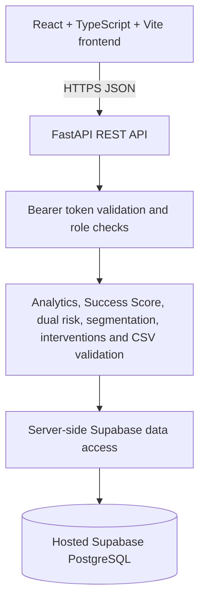

# EduNexus AI

**Student Success & Journey Intelligence Platform**

EduNexus AI is a Smart Campus Analytics platform that brings student evidence into one staff-facing workspace, provides explainable student-success and risk indicators, and helps authorized staff coordinate interventions and review outcomes.

[](https://react.dev/) [](https://www.typescriptlang.org/) [](https://fastapi.tiangolo.com/) [](https://supabase.com/) [](https://render.com/)

> **Production data policy:** the deployed application must use the configured hosted Supabase database. Production must never fall back to repository seed files, an in-memory dataset, or developer-local data. Do not seed or reset the production database.

## Product goals

Colleges often manage academics, attendance, learning-platform activity, engagement, skills, feedback and placement preparation in separate systems. EduNexus AI is designed to help faculty and advisors review that evidence, understand potential concerns and record human-led support.

Core capabilities:
- **Executive Dashboard:** cohort indicators, domain coverage, risk distributions and analytics supported by the API.
- **Student Directory:** search, filters, sorting and pagination supported by the backend.
- **Student Journey:** individual student context, available domain evidence, score/risk explanations, missing-data notices and timeline.
- **Analytics and Segmentation:** cohort-level patterns, segments and independent academic/placement risk views.
- **Intervention Tracking:** support plans, permitted status transitions, follow-up dates and outcome observations.
- **CSV Hub:** preview and validate supported domain data before importing it.

The product is a human-led decision-support tool. Indicators must not automatically trigger punitive decisions. A change observed after an intervention does not, by itself, establish causation.

## Seven student-data domains

| Domain | Example information | Intended use |
|---|---|---|
| Academic | CGPA, marks, assessments, backlogs | Review academic progress and support needs |
| Attendance | Recorded sessions and attendance rates | Identify patterns for human review |
| LMS | Learning-platform activity and assignment completion | Understand available digital-learning signals |
| Engagement | Events, clubs, workshops and hackathons | Add participation context to the journey |
| Placement | Aptitude, coding and mock interviews | Assess placement preparation separately |
| Skills | Technical and soft-skill assessments | Identify development opportunities |
| Feedback | Student satisfaction and faculty feedback | Add student-experience context |

Missing information must be shown as missing or unavailable, not silently interpreted as a measured zero.

## Architecture



- **Frontend:** React 19, TypeScript, Vite, Tailwind CSS v4, React Router and Recharts.
- **Backend:** Python, FastAPI, Pydantic, authentication/authorization, analytics and data-access services.
- **Database:** hosted Supabase PostgreSQL with migrations, constraints, audit records and Row Level Security where configured.
- **Hosting:** Render Static Site for the frontend and Render Web Service for the API.

The backend is the source of truth for score and risk calculations. The frontend must render API results rather than implement a second copy of the formulas.

## Student-success and risk indicators

- **Student Success Score:** a positive 0–100 index computed from available domain evidence, according to the current backend implementation.
- **Academic risk:** an independent academic-performance signal.
- **Placement risk:** an independent placement-readiness signal.
- **Legacy support-priority/risk index:** if returned by an endpoint, this is a deficit measure and must not be relabelled as the positive Success Score.

The current approach uses explainable deterministic rules; this repository does not establish validated predictive-model accuracy. Formula weights and thresholds are prototype design choices unless independently validated for institutional use.

## Deploy to Render

Deploy this monorepo as two services connected to the same GitHub repository and the selected hosted Supabase project. Leave **Root Directory** blank for both services; the commands below explicitly enter the appropriate folder.

### 1. Deploy the FastAPI backend

In [Render](https://dashboard.render.com/), create a **Web Service**:

| Setting | Value |
|---|---|
| Repository | `https://github.com/ambatitharunsai-tech/edunexus-ai` |
| Branch | `main` |
| Runtime | Python |
| Root Directory | Leave blank |
| Build Command | `cd backend && pip install -r requirements.txt && pytest -q` |
| Start Command | `cd backend && uvicorn app.main:app --host 0.0.0.0 --port $PORT` |
| Health Check Path | `/health` |

Configure these environment variables in the backend service settings. Enter credentials in Render's protected environment settings only; never add secrets to GitHub, this README or frontend variables.

| Variable | Value |
|---|---|
| `PROJECT_NAME` | `EduNexus AI` |
| `API_V1_STR` | `/api/v1` |
| `ENVIRONMENT` | `production` |
| `DEBUG` | `false` |
| `PORT` | Provided by Render; do not hardcode it |
| `ALLOWED_ORIGINS` | Exact HTTPS origin of the deployed frontend, with no trailing slash |
| `SUPABASE_URL` | URL of the hosted Supabase project |
| `SUPABASE_SERVICE_ROLE_KEY` | Server-only service-role key supported by the configured Supabase client |
| `SUPABASE_JWT_SECRET` | Signing secret required by the current backend verifier when the project uses HS256 |
| `SUPABASE_JWT_ISSUER` | Issuer expected by the backend; normally `https://<project-ref>.supabase.co/auth/v1` for the current verifier |

The current JWT implementation validates HS256 tokens. Confirm the Supabase project's signing-key configuration before production use. If the project uses asymmetric signing keys, implement and test the provider-supported JWKS verification flow before relying on those tokens.

After deployment, verify:
- `https://<api-service>.onrender.com/health`
- `https://<api-service>.onrender.com/docs`
- `https://<api-service>.onrender.com/openapi.json`

A successful health check only proves service liveness. It does not prove authentication, database connectivity or successful student-data operations.

### 2. Deploy the React frontend

Create a **Static Site** in Render:

| Setting | Value |
|---|---|
| Repository | `https://github.com/ambatitharunsai-tech/edunexus-ai` |
| Branch | `main` |
| Root Directory | Leave blank |
| Build Command | `cd frontend && npm ci && npm run build` |
| Publish Directory | `frontend/dist` |

Set these build-time environment variables on the Static Site:

| Variable | Value |
|---|---|
| `VITE_API_BASE_URL` | Full HTTPS URL of the deployed backend, without a trailing slash |
| `VITE_SUPABASE_URL` | Hosted Supabase project URL used by the app |
| `VITE_SUPABASE_ANON_KEY` | Public publishable/anonymous client key |

Vite embeds `VITE_*` variables into public browser assets. **Never** put `SUPABASE_SERVICE_ROLE_KEY`, a Supabase secret key or `SUPABASE_JWT_SECRET` in any `VITE_*` variable.

Configure a rewrite for React Router in the Render Static Site settings:

| Source | Destination | Action |
|---|---|---|
| `/*` | `/index.html` | Rewrite |

Copy the actual Static Site HTTPS origin into the backend's `ALLOWED_ORIGINS` and redeploy the backend. Use the exact deployed origin rather than a guessed URL.

### 3. Connect Supabase safely

The repository has SQL files under `supabase/migrations/`. Before applying them to any hosted database:

1. Inspect the live schema, existing tables, RPC functions, RLS policies and migration history.
2. Compare the live schema to the repository migrations and resolve any drift.
3. Back up the database before making schema changes.
4. Apply only reviewed, missing migrations through a controlled change process.
5. Verify the `edunexus_commit` RPC and all required columns exist before enabling writes.

**Never reapply migrations blindly, drop/reset the database or import the repository's synthetic seed files into production.** An existing schema with incomplete migration-history metadata must be reconciled before applying DDL.

## Production verification checklist

- [ ] Backend health, `/docs` and OpenAPI respond at the deployed API URL.
- [ ] Supabase tables and the required RPC match the application's expected schema.
- [ ] Backend database credentials are configured only in Render and verified by a live query.
- [ ] The frontend calls the deployed API; browser requests do not use `localhost`.
- [ ] CORS permits the exact deployed frontend origin.
- [ ] A valid production JWT is accepted and invalid/missing tokens are rejected for protected routes.
- [ ] Demo tokens are rejected in production; demo shortcuts are not used for production access.
- [ ] Student directory, journey, analytics and intervention operations read/write the hosted database.
- [ ] Authorized changes survive browser refresh and backend restart.
- [ ] CSV import and demo-reset safeguards are verified before enabling data mutations.
- [ ] No repository seed or in-memory dataset is used as the production source of truth.
- [ ] Supabase Security Advisor findings are reviewed before real student data is used.

Do not describe the application as production-ready until data, authentication, authorization and persistence have been tested—not merely the build and health endpoint.

## API endpoints

| Method | Path | Purpose |
|---|---|---|
| `GET` | `/health` | Service liveness |
| `GET` | `/` | API metadata |
| `GET` | `/api/v1/dashboard/overview` | Dashboard analytics |
| `GET` | `/api/v1/students` | Searchable and filterable directory |
| `GET` | `/api/v1/students/{student_id}` | Student details and journey |
| `GET` | `/api/v1/students/{student_id}/risk-explanation` | Risk explanation and overrides |
| `POST` | `/api/v1/interventions` | Create an authorized intervention |
| `PATCH` | `/api/v1/interventions/{id}` | Update an intervention under lifecycle rules |
| `POST` | `/api/v1/interventions/{id}/outcomes` | Record follow-up observations |
| `POST` | `/api/v1/csv/preview` | Validate CSV without import |
| `POST` | `/api/v1/csv/import` | Import supported validated rows |
| `POST` | `/api/v1/csv/reset-demo` | Reset synthetic demo data only; unavailable in persistent mode |

Check the deployed `/docs` endpoint for the current request/response schema and authorization requirements.

## Security and responsible use

- Keep privileged Supabase credentials and JWT secrets on the backend only.
- Protect browser-facing publishable keys with correct RLS policies and least-privilege permissions.
- Use server-side authentication, authorization, validation and audit controls with any privileged database key.
- Demo bearer tokens are disabled when `ENVIRONMENT=production`.
- Use synthetic records for tests only. Do not place real student records in public issues, logs, screenshots or documentation.
- Treat risk indicators as prompts for professional review; do not use them alone for punitive decisions.
- Report before/after measurements as observations, not proof of causation.

The connected Supabase project currently reports Security Advisor warnings about exposed `SECURITY DEFINER` helper functions. Review those warnings and their required permissions before treating the database as production-ready: [Supabase Security Advisor](https://supabase.com/docs/guides/database/database-linter).

## Repository map

```text
.
├── backend/
│   ├── app/api/v1/       # Health, dashboard, students, interventions and CSV routes
│   ├── app/core/         # Settings, authentication, errors and risk configuration
│   ├── app/db/           # Supabase client and data-access code
│   ├── app/schemas/      # Pydantic request/response models
│   ├── app/services/     # Analytics, scoring, risk, segmentation and CSV logic
│   ├── requirements.txt
│   └── tests/
├── frontend/
│   ├── src/pages/        # Dashboard, students, journey, analytics, interventions, CSV Hub and login
│   ├── src/components/   # Shared UI components
│   ├── src/lib/          # API, auth, Supabase client and utilities
│   └── package.json
├── supabase/migrations/  # Ordered schema and policy changes
├── docs/                 # Architecture, API, page/file guides and verification reports
├── data/                 # Synthetic fixtures for development/testing only
└── README.md
```

## Verification records

See [`docs/TEST_AND_VERIFICATION_REPORT.md`](docs/TEST_AND_VERIFICATION_REPORT.md) and [`docs/FINAL_INTEGRATION_VERIFICATION.md`](docs/FINAL_INTEGRATION_VERIFICATION.md) for the latest recorded checks and their limitations. Test results from an earlier commit are not proof that the current deployed commit passed. Report frontend browser testing and live database checks separately when they have not been run.

## Documentation

- [`DOCUMENTATION.md`](DOCUMENTATION.md) — technical overview.
- [`DOCUMENTATION_AUDIT_REPORT.md`](DOCUMENTATION_AUDIT_REPORT.md) — previous documentation audit.
- [`docs/API_CONTRACTS.md`](docs/API_CONTRACTS.md) — API contract map.
- [`docs/ARCHITECTURE_DIAGRAM.md`](docs/ARCHITECTURE_DIAGRAM.md) — architecture diagram.
- [`docs/PAGE_BY_PAGE_GUIDE.md`](docs/PAGE_BY_PAGE_GUIDE.md) — page and feature guide.
- [`docs/FILE_BY_FILE_GUIDE.md`](docs/FILE_BY_FILE_GUIDE.md) — source-file guide.
- [`docs/MANUAL_UI_SMOKE_TEST.md`](docs/MANUAL_UI_SMOKE_TEST.md) — manual browser checklist.

## Project

Repository: [ambatitharunsai-tech/edunexus-ai](https://github.com/ambatitharunsai-tech/edunexus-ai)

Deployment target: [Render](https://render.com/)

Challenge context: KPMG in India — Smart Campus Analytics: Predict, Optimize & Improve Student Success.
