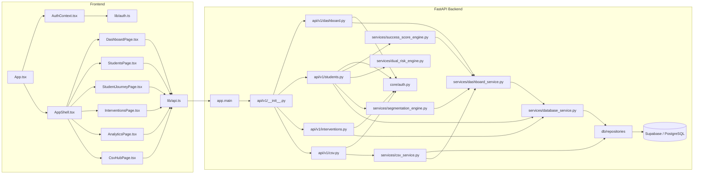

# Architecture Diagram (Verified)

## Notes
- This diagram reflects the active codebase and verified routes.
- The synthetic/demo fallback is handled by dataset and service logic, not by a separate runtime app. The backend chooses between configured live DB mode and the in-memory synthetic dataset.
- Missing-data handling and risk scoring remain backend-owned, not duplicated into React.
