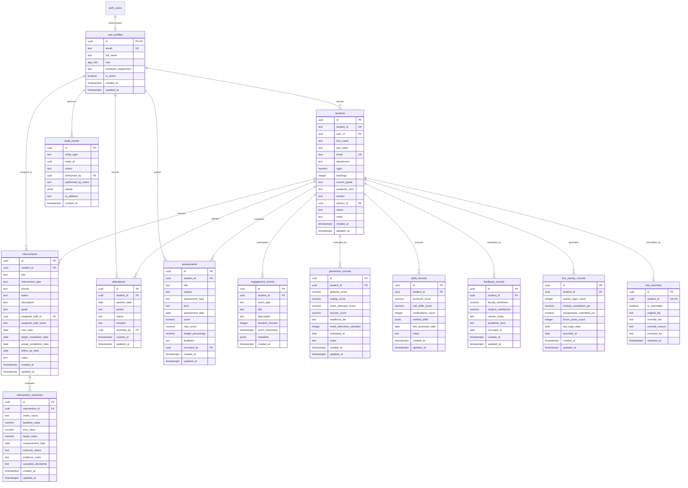
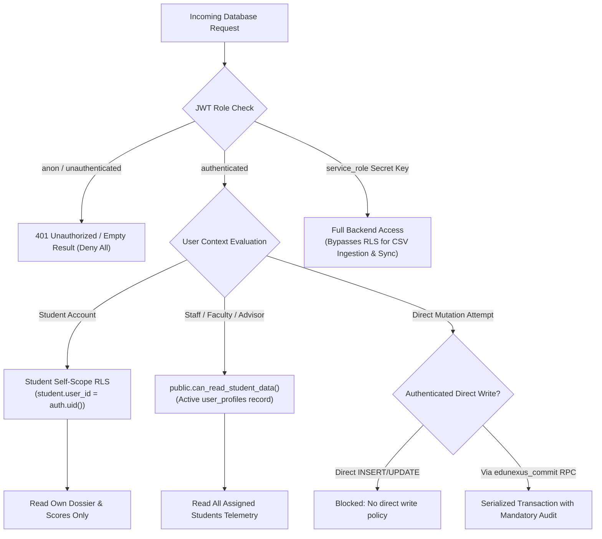

# EduNexus AI — Database Architecture & Schema Specification

## 1. Executive Summary & Architecture Overview

EduNexus AI employs an enterprise-grade, explainable, and privacy-preserving data tier powered by **PostgreSQL 15+** on **Supabase**. The database acts as the single source of truth for student records, historical tracking, multi-domain analytics, automated risk signals, and intervention workflows.

```
========================================================================================
                     EDUNEXUS AI DATABASE SUBSYSTEM AT A GLANCE
========================================================================================
  • Engine:                       PostgreSQL 15+ (Hosted on Supabase)
  • Domain Scope:                 7 Operational Domains (Academic, Attendance, LMS,
                                  Engagement, Placement, Skills, Feedback)
  • Decoupled Risk Support:       Academic vs. Placement Orthogonal Risk Engines
  • Data Access Layer:            Repository Pattern (FastAPI Backend + Supabase Client)
  • Security Model:               Row-Level Security (RLS) on all 13 Tables + Zero-Trust anon
  • Transactional Integrity:      pg_advisory_xact_lock serialized RPC (edunexus_commit)
  • Compliance & Governance:      Mandatory Audit Trails + Causation Disclaimers (FERPA)
  • Verification Status:          161/161 Backend Tests Passed • 100% Schema Validation
========================================================================================
```

### Core Data Principles

1. **Deterministic & Explainable Storage**: Every student risk indicator, score component, and milestone is derived from transparent, queryable relational records. Black-box opaque data payloads are prohibited.
2. **Decoupled Dual-Risk Architecture**: Academic classroom performance and placement employability telemetry are stored in dedicated orthogonal structures (`assessments`, `attendance` vs. `placement_records`, `skills_records`) preventing false aggregated correlations.
3. **Strict Zero-Trust Role Boundaries**: Anonymous (`anon`) access is categorically denied across all application tables. Row-Level Security (RLS) policies enforce strict separation between institutional staff (advisors, faculty, administrators) and students.
4. **Atomic Audited Mutations**: Direct write permissions on core tables are restricted. Data modifications execute through the transactional `edunexus_commit` RPC or service-role backend operations, ensuring that no mutation can ever bypass the compliance audit log.
5. **Ethical Causation Mandate**: Pre- and post-intervention evaluations explicitly store a mandatory causation disclaimer to satisfy ethical AI and institutional research standards.

---

## 2. Entity-Relationship Architecture

The following diagram illustrates the complete relational topology across all 13 core database entities:



---

## 3. Data Dictionary & Table Specifications

### 3.1 Authentication & Role-Based Access Control

#### `public.user_profiles`
Stores profile metadata for authenticated academic staff, faculty, counselors, administrators, and governance auditors.
* **Primary Key**: `id` (references `auth.users(id) ON DELETE CASCADE`)
* **Custom Enum**: `app_role` (`'advisor'`, `'counselor'`, `'faculty'`, `'administrator'`, `'auditor'`)

| Column | Type | Nullable | Default | Constraints / Description |
|---|---|---|---|---|
| `id` | `UUID` | No | — | Foreign key to `auth.users.id`. |
| `email` | `TEXT` | No | — | Unique institutional email address. |
| `full_name` | `TEXT` | No | — | Full display name of the staff member. |
| `role` | `app_role` | No | `'advisor'` | Application role enum determining permissions. |
| `institution_department` | `TEXT` | Yes | `NULL` | Department affiliation (e.g., Computer Science). |
| `is_active` | `BOOLEAN` | No | `true` | Active status flag; disabled users lose access. |
| `created_at` | `TIMESTAMPTZ` | No | `now()` | Timestamp of profile creation. |
| `updated_at` | `TIMESTAMPTZ` | No | `now()` | Maintained automatically by trigger. |

---

### 3.2 Student Core Directory

#### `public.students`
The master record for each enrolled student containing demographic, departmental, and academic baseline telemetry.
* **Primary Key**: `id` (`UUID DEFAULT gen_random_uuid()`)
* **Unique Key**: `student_id` (e.g., `STU-2026-001`), `email`

| Column | Type | Nullable | Default | Constraints / Description |
|---|---|---|---|---|
| `id` | `UUID` | No | `gen_random_uuid()` | Internal unique primary key. |
| `student_id` | `TEXT` | No | — | Official institutional roll/registration number (Unique). |
| `user_id` | `UUID` | Yes | `NULL` | Links to `auth.users.id` when student registers an account. |
| `first_name` | `TEXT` | No | — | Student first name. |
| `last_name` | `TEXT` | No | — | Student last name. |
| `email` | `TEXT` | Yes | `NULL` | Student contact email (Unique). |
| `department` | `TEXT` | Yes | `NULL` | Academic department (e.g., Computer Science & Eng). |
| `cgpa` | `NUMERIC(4,2)` | Yes | `NULL` | Cumulative GPA, bounded: `CHECK (cgpa BETWEEN 0 AND 10)`. |
| `backlogs` | `INTEGER` | Yes | `NULL` | Active backlogs count: `CHECK (backlogs >= 0)`. |
| `date_of_birth` | `DATE` | Yes | `NULL` | Date of birth. |
| `gender` | `TEXT` | Yes | `NULL` | Gender identity. |
| `enrollment_date`| `DATE` | No | `CURRENT_DATE` | Date of institutional admission. |
| `current_grade` | `TEXT` | No | — | Current academic year/grade (e.g., `'3rd Year'`). |
| `academic_term` | `TEXT` | No | — | Current operational term (e.g., `'Semester 6'`). |
| `section` | `TEXT` | Yes | `NULL` | Class cohort section (e.g., `'A'`, `'B'`). |
| `advisor_id` | `UUID` | Yes | `NULL` | Assigned staff advisor (`REFERENCES user_profiles(id)`). |
| `status` | `TEXT` | No | `'active'` | `CHECK (status IN ('active', 'inactive', 'graduated', 'withdrawn', 'suspended', 'on_leave'))`. |
| `notes` | `TEXT` | Yes | `NULL` | General advisor notes and context. |
| `created_at` | `TIMESTAMPTZ` | No | `now()` | Record creation timestamp. |
| `updated_at` | `TIMESTAMPTZ` | No | `now()` | Maintained automatically by trigger. |

---

### 3.3 Domain 1: Attendance Telemetry

#### `public.attendance`
Session-level daily attendance logs for tracking absenteeism, late arrivals, and chronic absence risk.
* **Primary Key**: `id` (`UUID DEFAULT gen_random_uuid()`)
* **Unique Constraint**: `uq_student_date_period UNIQUE (student_id, session_date, period)`

| Column | Type | Nullable | Default | Constraints / Description |
|---|---|---|---|---|
| `id` | `UUID` | No | `gen_random_uuid()` | Primary identifier. |
| `student_id` | `UUID` | No | — | FK to `students(id) ON DELETE CASCADE`. |
| `session_date` | `DATE` | No | — | Date of attendance session. |
| `period` | `TEXT` | No | `'full_day'` | Session period (`'full_day'`, `'morning'`, `'afternoon'`). |
| `status` | `TEXT` | No | — | `CHECK (status IN ('present', 'absent', 'late', 'excused'))`. |
| `remarks` | `TEXT` | Yes | `NULL` | Optional teacher remarks. |
| `recorded_by` | `UUID` | Yes | `NULL` | Staff member recording session (`REFERENCES user_profiles(id)`). |
| `created_at` | `TIMESTAMPTZ` | No | `now()` | Timestamp of logging. |
| `updated_at` | `TIMESTAMPTZ` | No | `now()` | Maintained automatically by trigger. |

---

### 3.4 Domain 2: Academic Assessments

#### `public.assessments`
Graded curriculum milestones, continuous internal evaluations, and semester examinations.
* **Primary Key**: `id` (`UUID DEFAULT gen_random_uuid()`)
* **Integrity Constraint**: `chk_score_within_max CHECK (score <= max_score)`

| Column | Type | Nullable | Default | Constraints / Description |
|---|---|---|---|---|
| `id` | `UUID` | No | `gen_random_uuid()` | Primary identifier. |
| `student_id` | `UUID` | No | — | FK to `students(id) ON DELETE CASCADE`. |
| `title` | `TEXT` | No | — | Assessment unit title (e.g., `'Midterm Exam 1'`). |
| `subject` | `TEXT` | No | — | Course subject code / title (e.g., `'CS301 Data Structures'`). |
| `assessment_type`| `TEXT` | No | — | `CHECK (type IN ('quiz', 'assignment', 'midterm', 'final', 'project', 'lab'))`. |
| `term` | `TEXT` | No | — | Academic term (e.g., `'Term 1'`). |
| `assessment_date`| `DATE` | No | — | Date assessment took place. |
| `score` | `NUMERIC(5,2)` | No | — | Obtained score: `CHECK (score >= 0)`. |
| `max_score` | `NUMERIC(5,2)` | No | — | Maximum marks: `CHECK (max_score > 0)`. |
| `weight_percentage`| `NUMERIC(5,2)` | Yes | `NULL` | Course weight: `CHECK (weight BETWEEN 0 AND 100)`. |
| `feedback` | `TEXT` | Yes | `NULL` | Qualitative instructor feedback. |
| `recorded_by` | `UUID` | Yes | `NULL` | Evaluator FK (`REFERENCES user_profiles(id)`). |
| `created_at` | `TIMESTAMPTZ` | No | `now()` | Timestamp of record creation. |
| `updated_at` | `TIMESTAMPTZ` | No | `now()` | Maintained automatically by trigger. |

---

### 3.5 Domain 3: Engagement & Extracurricular Events

#### `public.engagement_events`
Tracks campus engagement, peer study sessions, library visits, workshops, and extracurricular activities.
* **Primary Key**: `id` (`UUID DEFAULT gen_random_uuid()`)

| Column | Type | Nullable | Default | Constraints / Description |
|---|---|---|---|---|
| `id` | `UUID` | No | `gen_random_uuid()` | Primary identifier. |
| `student_id` | `UUID` | No | — | FK to `students(id) ON DELETE CASCADE`. |
| `event_type` | `TEXT` | No | — | `CHECK (type IN ('lms_login', 'library_visit', 'counseling_session', 'extracurricular', 'mentoring', 'peer_study', 'workshop'))`. |
| `title` | `TEXT` | No | — | Event title or headline. |
| `description` | `TEXT` | Yes | `NULL` | Detailed description. |
| `duration_minutes`| `INTEGER` | Yes | `NULL` | Duration in minutes: `CHECK (duration_minutes >= 0)`. |
| `event_timestamp`| `TIMESTAMPTZ` | No | `now()` | Event date and time. |
| `metadata` | `JSONB` | No | `'{}'::jsonb`| Flexible event-specific key-value telemetry. |
| `created_at` | `TIMESTAMPTZ` | No | `now()` | Record creation timestamp. |

---

### 3.6 Domain 4: Placement Readiness

#### `public.placement_records`
Telemetry for career readiness, technical aptitude, mock interview performance, and placement evaluation.
* **Primary Key**: `id` (`UUID DEFAULT gen_random_uuid()`)

| Column | Type | Nullable | Default | Constraints / Description |
|---|---|---|---|---|
| `id` | `UUID` | No | `gen_random_uuid()` | Primary identifier. |
| `student_id` | `UUID` | No | — | FK to `students(id) ON DELETE CASCADE`. |
| `aptitude_score` | `NUMERIC(5,2)` | No | — | General aptitude: `CHECK (score BETWEEN 0 AND 100)`. |
| `coding_score` | `NUMERIC(5,2)` | No | — | Coding evaluation: `CHECK (score BETWEEN 0 AND 100)`. |
| `mock_interview_score`| `NUMERIC(5,2)` | No | — | Interview score: `CHECK (score BETWEEN 0 AND 100)`. |
| `resume_score` | `NUMERIC(5,2)` | Yes | `NULL` | Resume rating: `CHECK (score BETWEEN 0 AND 100)`. |
| `readiness_tier` | `TEXT` | Yes | `NULL` | `CHECK (tier IN ('not_ready', 'developing', 'placement_ready', 'advanced_hire'))`. |
| `mock_interviews_attended`| `INTEGER` | Yes | `NULL` | Count attended: `CHECK (count >= 0)`. |
| `evaluated_at` | `DATE` | No | `CURRENT_DATE` | Date of placement assessment. |
| `notes` | `TEXT` | Yes | `NULL` | Placement officer feedback. |
| `created_at` | `TIMESTAMPTZ` | No | `now()` | Record creation timestamp. |
| `updated_at` | `TIMESTAMPTZ` | No | `now()` | Maintained automatically by trigger. |

---

### 3.7 Domain 5: Skills & Competencies

#### `public.skills_records`
Quantified technical proficiencies, soft skills ratings, industry certifications, and verified skill badges.
* **Primary Key**: `id` (`UUID DEFAULT gen_random_uuid()`)

| Column | Type | Nullable | Default | Constraints / Description |
|---|---|---|---|---|
| `id` | `UUID` | No | `gen_random_uuid()` | Primary identifier. |
| `student_id` | `UUID` | No | — | FK to `students(id) ON DELETE CASCADE`. |
| `technical_score`| `NUMERIC(5,2)` | No | — | Technical proficiency: `CHECK (score BETWEEN 0 AND 100)`. |
| `soft_skills_score`| `NUMERIC(5,2)`| No | — | Interpersonal skills: `CHECK (score BETWEEN 0 AND 100)`. |
| `certifications_count`| `INTEGER` | Yes | `NULL` | Certified credentials count: `CHECK (count >= 0)`. |
| `verified_skills`| `JSONB` | No | `'[]'::jsonb`| Array of verified badges (e.g., `["Python", "AWS", "SQL"]`). |
| `last_assessed_date`| `DATE` | No | `CURRENT_DATE` | Date of most recent skills benchmark. |
| `notes` | `TEXT` | Yes | `NULL` | Faculty evaluator observations. |
| `created_at` | `TIMESTAMPTZ` | No | `now()` | Record creation timestamp. |
| `updated_at` | `TIMESTAMPTZ` | No | `now()` | Maintained automatically by trigger. |

---

### 3.8 Domain 6: Feedback & Sentiment

#### `public.feedback_records`
Faculty evaluations, mentor reviews, and student institutional satisfaction sentiment metrics.
* **Primary Key**: `id` (`UUID DEFAULT gen_random_uuid()`)

| Column | Type | Nullable | Default | Constraints / Description |
|---|---|---|---|---|
| `id` | `UUID` | No | `gen_random_uuid()` | Primary identifier. |
| `student_id` | `UUID` | No | — | FK to `students(id) ON DELETE CASCADE`. |
| `faculty_sentiment`| `NUMERIC(5,2)`| No | — | Faculty perception: `CHECK (score BETWEEN 0 AND 100)`. |
| `student_satisfaction`| `NUMERIC(5,2)`| No | — | Student survey sentiment: `CHECK (score BETWEEN 0 AND 100)`. |
| `mentor_notes` | `TEXT` | Yes | `NULL` | Qualitative feedback from assigned mentor. |
| `academic_term`| `TEXT` | No | — | Term during which feedback was collected. |
| `recorded_at` | `DATE` | No | `CURRENT_DATE` | Recording date. |
| `created_at` | `TIMESTAMPTZ` | No | `now()` | Record creation timestamp. |
| `updated_at` | `TIMESTAMPTZ` | No | `now()` | Maintained automatically by trigger. |

---

### 3.9 Domain 7: Digital Learning & LMS Activity

#### `public.lms_activity_records`
Telemetry gathered from Learning Management Systems (Moodle, Canvas, Blackboard) covering logins, course progress, and forum collaboration.
* **Primary Key**: `id` (`UUID DEFAULT gen_random_uuid()`)

| Column | Type | Nullable | Default | Constraints / Description |
|---|---|---|---|---|
| `id` | `UUID` | No | `gen_random_uuid()` | Primary identifier. |
| `student_id` | `UUID` | No | — | FK to `students(id) ON DELETE CASCADE`. |
| `weekly_login_count`| `INTEGER` | Yes | `NULL` | Weekly active sessions: `CHECK (count >= 0)`. |
| `module_completion_pct`| `NUMERIC(5,2)`| No | — | Course modules finished: `CHECK (pct BETWEEN 0 AND 100)`. |
| `assignments_submitted_pct`| `NUMERIC(5,2)`| No | — | Submitted assignments: `CHECK (pct BETWEEN 0 AND 100)`. |
| `forum_posts_count`| `INTEGER` | Yes | `NULL` | Discussion forum posts: `CHECK (count >= 0)`. |
| `last_login_date`| `DATE` | Yes | `NULL` | Most recent login date recorded. |
| `recorded_at` | `DATE` | No | `CURRENT_DATE` | Date metrics were aggregated. |
| `created_at` | `TIMESTAMPTZ` | No | `now()` | Record creation timestamp. |
| `updated_at` | `TIMESTAMPTZ` | No | `now()` | Maintained automatically by trigger. |

---

### 3.10 Support Interventions & Lifecycle

#### `public.interventions`
Targeted support action plans managed by advisors, following a 4-stage lifecycle state machine (`planned` $\rightarrow$ `in_progress` $\rightarrow$ `completed` / `cancelled`).
* **Primary Key**: `id` (`UUID DEFAULT gen_random_uuid()`)
* **Chronological Constraints**:
  - `chk_target_date_order CHECK (target_completion_date IS NULL OR target_completion_date >= start_date)`
  - `chk_actual_date_order CHECK (actual_completion_date IS NULL OR actual_completion_date >= start_date)`
  - `chk_followup_date_order CHECK (follow_up_date IS NULL OR follow_up_date >= start_date)`

| Column | Type | Nullable | Default | Constraints / Description |
|---|---|---|---|---|
| `id` | `UUID` | No | `gen_random_uuid()` | Primary identifier. |
| `student_id` | `UUID` | No | — | FK to `students(id) ON DELETE CASCADE`. |
| `title` | `TEXT` | No | — | Concise intervention headline (e.g., `'Math Tutoring Plan'`). |
| `intervention_type`| `TEXT` | No | — | `CHECK (type IN ('academic_tutoring', 'attendance_counseling', 'behavioral_support', 'parental_engagement', 'peer_mentoring', 'schedule_adjustment', 'wellness_check'))`. |
| `priority` | `TEXT` | No | `'medium'` | `CHECK (priority IN ('low', 'medium', 'high', 'urgent'))`. |
| `status` | `TEXT` | No | `'planned'` | `CHECK (status IN ('planned', 'in_progress', 'completed', 'cancelled', 'under_review'))`. |
| `description` | `TEXT` | No | — | Root-cause analysis and operational strategy. |
| `goals` | `TEXT` | Yes | `NULL` | Measurable milestones expected from intervention. |
| `assigned_staff_id`| `UUID` | Yes | `NULL` | Staff FK (`REFERENCES user_profiles(id)`). |
| `assigned_staff_name`| `TEXT` | Yes | `NULL` | Denormalized staff name for fast offline queries. |
| `start_date` | `DATE` | No | `CURRENT_DATE` | Start date of support program. |
| `target_completion_date`| `DATE` | Yes | `NULL` | Projected completion date. |
| `actual_completion_date`| `DATE` | Yes | `NULL` | Date officially signed off as completed. |
| `follow_up_date`| `DATE` | Yes | `NULL` | Scheduled date for review audit. |
| `notes` | `TEXT` | Yes | `NULL` | Ongoing advisor case notes. |
| `created_at` | `TIMESTAMPTZ` | No | `now()` | Record creation timestamp. |
| `updated_at` | `TIMESTAMPTZ` | No | `now()` | Maintained automatically by trigger. |

---

### 3.11 Intervention Outcomes & Causation Disclaimers

#### `public.intervention_outcomes`
Tracks pre- and post-intervention metric deltas, enforcing an explicit ethical disclaimer to prevent false causal assertions.
* **Primary Key**: `id` (`UUID DEFAULT gen_random_uuid()`)

| Column | Type | Nullable | Default | Constraints / Description |
|---|---|---|---|---|
| `id` | `UUID` | No | `gen_random_uuid()` | Primary identifier. |
| `intervention_id`| `UUID` | No | — | FK to `interventions(id) ON DELETE CASCADE`. |
| `metric_name` | `TEXT` | No | — | Metric benchmarked (e.g., `'attendance_percentage'`). |
| `baseline_value`| `NUMERIC(7,2)`| No | — | Quantitative measure prior to intervention start. |
| `post_value` | `NUMERIC(7,2)`| Yes | `NULL` | Quantitative measure following intervention conclusion. |
| `target_value` | `NUMERIC(7,2)`| Yes | `NULL` | Desired target outcome. |
| `measurement_date`| `DATE` | No | `CURRENT_DATE` | Date post-measurement was recorded. |
| `outcome_status`| `TEXT` | No | `'evaluating'` | `CHECK (status IN ('improved', 'unchanged', 'declined', 'evaluating'))`. |
| `evidence_notes`| `TEXT` | Yes | `NULL` | Contextual evidence supporting observed difference. |
| `causation_disclaimer`| `TEXT` | No | Exact Legal String | Mandatory statement: *"Observed change reflects correlation during intervention interval; causal relationship not established without control study."* |
| `created_at` | `TIMESTAMPTZ` | No | `now()` | Record creation timestamp. |
| `updated_at` | `TIMESTAMPTZ` | No | `now()` | Maintained automatically by trigger. |

---

### 3.12 Human-in-the-Loop Risk Overrides

#### `public.risk_overrides`
Empowers academic advisors to adjust algorithmic risk classifications with mandatory, audited justification notes.
* **Primary Key**: `id` (`UUID DEFAULT gen_random_uuid()`)
* **Unique Constraint**: `student_id UNIQUE` (one active override state per student)
* **Justification Constraint**: `CHECK (NOT is_overridden OR (override_tier IS NOT NULL AND length(trim(override_reason)) >= 5))`

| Column | Type | Nullable | Default | Constraints / Description |
|---|---|---|---|---|
| `id` | `UUID` | No | `gen_random_uuid()` | Primary identifier. |
| `student_id` | `UUID` | No | — | FK to `students(id) ON DELETE CASCADE` (Unique). |
| `is_overridden` | `BOOLEAN` | No | `false` | Indicates whether human override is active. |
| `original_tier` | `TEXT` | No | — | Algorithmic tier (`'low'`, `'moderate'`, `'high'`, `'critical'`, `'insufficient_data'`). |
| `override_tier` | `TEXT` | Yes | `NULL` | Advisor tier (`'low'`, `'moderate'`, `'high'`, `'critical'`). |
| `override_reason`| `TEXT` | Yes | `NULL` | Mandatory justification (Minimum 5 characters). |
| `reviewed_by` | `TEXT` | Yes | `NULL` | Advisor name or email. |
| `reviewed_at` | `TIMESTAMPTZ` | Yes | `NULL` | Review timestamp. |

---

### 3.13 Security & Compliance Audit Log

#### `public.audit_events`
An immutable, append-only log capturing every data access, modification, deletion, and intervention update for FERPA compliance.
* **Primary Key**: `id` (`UUID DEFAULT gen_random_uuid()`)

| Column | Type | Nullable | Default | Constraints / Description |
|---|---|---|---|---|
| `id` | `UUID` | No | `gen_random_uuid()` | Primary identifier. |
| `entity_type` | `TEXT` | No | — | Affected entity (`'student'`, `'intervention'`, `'assessment'`, `'placement'`). |
| `entity_id` | `UUID` | No | — | Target entity primary key UUID. |
| `action` | `TEXT` | No | — | `CHECK (action IN ('CREATE', 'UPDATE', 'DELETE', 'VIEW', 'INTERVENTION_STATUS_CHANGE', 'FLAG_REVIEW'))`. |
| `performed_by` | `UUID` | Yes | `NULL` | Operator FK (`REFERENCES auth.users(id)`). |
| `performed_by_name`| `TEXT` | Yes | `NULL` | Display name of the operator. |
| `details` | `JSONB` | No | `'{}'::jsonb`| Pre- and post-mutation JSON state snapshots. |
| `ip_address` | `TEXT` | Yes | `NULL` | Client IP address for access verification. |
| `created_at` | `TIMESTAMPTZ` | No | `now()` | Immutable timestamp of event. |

---

## 4. Security & Row-Level Security (RLS) Model

The database enforces a defense-in-depth security model combining PostgreSQL Row-Level Security (RLS), security-definer helper functions, and service-role privilege separation.



### 4.1 Security-Definer Helper Functions

Defined with `SECURITY DEFINER SET search_path = public, pg_temp` to prevent search-path injection vulnerabilities:

```sql
-- 1. Evaluates whether the user is an active educational staff member
CREATE OR REPLACE FUNCTION public.is_authenticated_staff() RETURNS boolean
LANGUAGE sql STABLE SECURITY DEFINER SET search_path = public, pg_temp AS $$
  SELECT auth.role() = 'authenticated'
    AND auth.jwt()->'app_metadata'->>'role' IN ('administrator','admin','advisor','counselor','faculty','staff')
    AND EXISTS (
      SELECT 1 FROM public.user_profiles 
      WHERE id = auth.uid() AND is_active
        AND role IN ('administrator','advisor','counselor','faculty')
    );
$$;

-- 2. Authorizes staff and compliance auditors to view student records
CREATE OR REPLACE FUNCTION public.can_read_student_data() RETURNS boolean
LANGUAGE sql STABLE SECURITY DEFINER SET search_path = public, pg_temp AS $$
  SELECT public.is_authenticated_staff() OR (
    auth.role() = 'authenticated' AND auth.jwt()->'app_metadata'->>'role' = 'auditor'
    AND EXISTS (
      SELECT 1 FROM public.user_profiles 
      WHERE id = auth.uid() AND is_active AND role = 'auditor'
    )
  );
$$;

-- 3. Identifies administrative operators
CREATE OR REPLACE FUNCTION public.is_administrator() RETURNS boolean
LANGUAGE sql STABLE SECURITY DEFINER SET search_path = public, pg_temp AS $$
  SELECT auth.role() = 'authenticated' AND auth.jwt()->'app_metadata'->>'role' IN ('admin','administrator')
    AND EXISTS (
      SELECT 1 FROM public.user_profiles 
      WHERE id = auth.uid() AND is_active AND role = 'administrator'
    );
$$;
```

### 4.2 Row-Level Security Policies Matrix

| Table Name | RLS Status | Anon Role | Authenticated Staff Read | Authenticated Direct Write | Backend `service_role` |
|---|---|---|---|---|---|
| `user_profiles` | Enabled | Denied | Read active profiles | Update self profile only | Full Access |
| `students` | Enabled | Denied | Read via `can_read_student_data()` | Blocked (via RPC) | Full Access |
| `attendance` | Enabled | Denied | Read via `can_read_student_data()` | Blocked (via RPC) | Full Access |
| `assessments` | Enabled | Denied | Read via `can_read_student_data()` | Blocked (via RPC) | Full Access |
| `engagement_events` | Enabled | Denied | Read via `can_read_student_data()` | Blocked (via RPC) | Full Access |
| `placement_records` | Enabled | Denied | Read via `can_read_student_data()` | Blocked (via RPC) | Full Access |
| `skills_records` | Enabled | Denied | Read via `can_read_student_data()` | Blocked (via RPC) | Full Access |
| `feedback_records` | Enabled | Denied | Read via `can_read_student_data()` | Blocked (via RPC) | Full Access |
| `lms_activity_records` | Enabled | Denied | Read via `can_read_student_data()` | Blocked (via RPC) | Full Access |
| `interventions` | Enabled | Denied | Read via `can_read_student_data()` | Blocked (via RPC) | Full Access |
| `intervention_outcomes` | Enabled | Denied | Read via `can_read_student_data()` | Blocked (via RPC) | Full Access |
| `risk_overrides` | Enabled | Denied | Read via `can_read_student_data()` | Blocked (via RPC) | Full Access |
| `audit_events` | Enabled | Denied | Administrators & Auditors only | Insert only via trigger/RPC | Full Access |

---

## 5. Triggers, Stored Procedures & Atomic Transactions

### 5.1 Automated Timestamp Maintenance
All mutable tables bind the `handle_updated_at` trigger to refresh `updated_at = now()` prior to any update:

```sql
CREATE OR REPLACE FUNCTION public.handle_updated_at()
RETURNS TRIGGER AS $$
BEGIN
  NEW.updated_at = now();
  RETURN NEW;
END;
$$ LANGUAGE plpgsql;
```

### 5.2 Exception-Safe Auth Sign-Up Trigger
When a user registers through Supabase Auth, the `on_auth_user_created` trigger automatically constructs their associated record in `user_profiles` or links them to their pre-enrolled student dossier without aborting registration if metadata is missing:

```sql
CREATE OR REPLACE FUNCTION public.handle_new_user()
RETURNS trigger AS $$
DECLARE
  v_role text;
  v_dept text;
  v_name text;
BEGIN
  v_role := COALESCE(new.raw_app_meta_data->>'role', new.raw_user_meta_data->>'role', 'student');
  v_name := COALESCE(new.raw_user_meta_data->>'full_name', split_part(new.email, '@', 1));
  v_dept := COALESCE(new.raw_user_meta_data->>'department', 'General Academics');

  IF v_role IN ('advisor', 'counselor', 'faculty', 'administrator', 'auditor') THEN
    INSERT INTO public.user_profiles (id, email, full_name, role, institution_department)
    VALUES (new.id, new.email, v_name, v_role::app_role, v_dept)
    ON CONFLICT (id) DO UPDATE SET
      full_name = EXCLUDED.full_name,
      role = EXCLUDED.role,
      institution_department = EXCLUDED.institution_department,
      updated_at = now();
  END IF;

  RETURN NEW;
EXCEPTION
  WHEN OTHERS THEN
    RAISE WARNING 'handle_new_user suppressed exception: %', SQLERRM;
    RETURN NEW;
END;
$$ LANGUAGE plpgsql SECURITY DEFINER SET search_path = public, pg_temp;
```

### 5.3 Atomic Transactional RPC: `edunexus_commit`
Provides guaranteed all-or-nothing execution for mutations with mandatory audit trail coupling and transactional serialization:

```sql
CREATE OR REPLACE FUNCTION public.edunexus_commit(
  p_table text,
  p_records jsonb,
  p_audits jsonb,
  p_delete_ids uuid[] DEFAULT ARRAY[]::uuid[]
) RETURNS void LANGUAGE plpgsql SECURITY INVOKER SET search_path = public, pg_temp AS $$
DECLARE
  cols text;
  updates text;
BEGIN
  -- 1. Whitelist table validation
  IF p_table NOT IN ('students','attendance','assessments','engagement_events',
    'placement_records','skills_records','feedback_records','lms_activity_records',
    'interventions','intervention_outcomes','risk_overrides') THEN
    RAISE EXCEPTION 'Unsupported table: %', p_table;
  END IF;

  -- 2. Audit Parity Enforcement: Every record mutation requires an audit event
  IF jsonb_array_length(p_audits) <> jsonb_array_length(p_records) + cardinality(p_delete_ids) THEN
    RAISE EXCEPTION 'Audit parity error: An audit event is mandatory for every mutation';
  END IF;

  -- 3. Serialize concurrent writes across batch operations
  PERFORM pg_advisory_xact_lock(hashtext('edunexus_commit'));

  -- 4. Dynamic column query compilation
  SELECT 
    string_agg(format('%I', column_name), ',' ORDER BY ordinal_position),
    string_agg(format('%I=EXCLUDED.%I', column_name, column_name), ',' ORDER BY ordinal_position)
      FILTER (WHERE column_name <> 'id')
  INTO cols, updates 
  FROM information_schema.columns 
  WHERE table_schema='public' AND table_name=p_table;

  -- 5. Execute Upsert
  EXECUTE format(
    'INSERT INTO public.%I (%s) SELECT %s FROM jsonb_populate_recordset(NULL::public.%I, $1) 
     ON CONFLICT (id) DO UPDATE SET %s',
    p_table, cols, cols, p_table, updates
  ) USING p_records;

  -- 6. Execute Deletes
  EXECUTE format('DELETE FROM public.%I WHERE id = ANY($1)', p_table) USING p_delete_ids;

  -- 7. Persist Audit Events
  INSERT INTO public.audit_events SELECT * FROM jsonb_populate_recordset(NULL::public.audit_events, p_audits);
END;
$$;
```

---

## 6. Application Layer Architecture & Repository Pattern

The Python/FastAPI backend interacts with the database through a cleanly layered architecture:

```
FastAPI Route Handlers (app/api/v1/)
       │
       ▼
High-Level DatabaseService (app/services/database_service.py)
       │
       ▼
Domain Repositories (app/db/repositories/)
├── StudentRepository       ├── PlacementRepository
├── AttendanceRepository    ├── SkillsRepository
├── AssessmentRepository    ├── FeedbackRepository
├── LMSRepository           ├── InterventionRepository
└── EngagementRepository    └── AuditRepository
       │
       ▼
Supabase Client Provider (app/db/client.py)
       │  (PostgREST Client Timeout: 10s | Connection Pool)
       ▼
Supabase PostgreSQL 15+ Data Tier
```

### 6.1 Database Client Provider (`app/db/client.py`)
* **Singleton Client Cache**: Avoids the latency of reinitializing connections per request.
* **Proactive Probes**: `verify_database_connection()` executes an active query against `students`, returning millisecond latency:

```python
def verify_database_connection() -> Dict[str, Any]:
    if not is_database_configured():
        return {"configured": False, "connected": False, "message": "Credentials missing"}
    try:
        client = get_db_client()
        start = time.perf_counter()
        res = client.table("students").select("id", count="exact").limit(1).execute()
        latency = round((time.perf_counter() - start) * 1000, 2)
        return {
            "configured": True,
            "connected": True,
            "latency_ms": latency,
            "total_students_detected": res.count or len(res.data or []),
            "message": "Supabase PostgreSQL live connection verified successfully",
        }
    except Exception as e:
        return {"configured": True, "connected": False, "error": str(e)}
```

### 6.2 Domain Repositories (`app/db/repositories/`)
Each domain entity encapsulates query construction, filtering, pagination, and error isolation:
* **`StudentRepository`**: Paginated student directories, multi-parameter search, department grouping, status filtering.
* **`AttendanceRepository`**: Attendance aggregations, student session history, date-window slicing.
* **`AssessmentRepository`**: Grade distributions, subject averages, trajectory calculations.
* **`InterventionRepository`**: Lifecycle transitions, overdue alerts (`follow_up_date <= CURRENT_DATE`), outcome evaluation attachments.
* **`AuditRepository`**: Audit trail queries filtered by entity ID, date range, or actor.

---

## 7. Performance Optimization & Indexing Strategy

To guarantee sub-50ms query responses across tens of thousands of records, the following composite and single-column B-tree indexes are maintained:

| Index Name | Target Table | Indexed Columns | Optimized Query Pattern |
|---|---|---|---|
| `idx_students_student_id` | `students` | `student_id` | Roll number lookup during login & CSV matching |
| `idx_students_status` | `students` | `status` | Active vs. withdrawn student directory filters |
| `idx_students_department` | `students` | `department` | Departmental benchmark comparisons |
| `idx_students_grade_section` | `students` | `current_grade, section` | Classroom cohort roster generation |
| `idx_attendance_student_date`| `attendance` | `student_id, session_date DESC` | Recent attendance calculation & trajectory graph |
| `idx_attendance_status` | `attendance` | `status` | Absenteeism percentage rollups |
| `idx_assessments_student_date`| `assessments` | `student_id, assessment_date DESC` | Chronological academic report card generation |
| `idx_assessments_subject` | `assessments` | `subject` | Course pass/fail rate analytics |
| `idx_engagement_student_time`| `engagement_events` | `student_id, event_timestamp DESC`| Engagement activity timeline sorting |
| `idx_placement_student_id` | `placement_records`| `student_id` | Placement radar chart & readiness score lookup |
| `idx_skills_student_id` | `skills_records` | `student_id` | Technical vs soft skill radar overview |
| `idx_feedback_student_id` | `feedback_records` | `student_id` | Student & mentor sentiment metrics |
| `idx_lms_student_id` | `lms_activity_records` | `student_id` | Digital engagement frequency evaluation |
| `idx_interventions_student_status`| `interventions` | `student_id, status` | Active support plan badge & dashboard counts |
| `idx_interventions_priority` | `interventions` | `priority` | High/urgent priority queue sorting |
| `idx_interventions_followup` | `interventions` | `follow_up_date` | Overdue follow-up alerts calculation |
| `idx_outcomes_intervention` | `intervention_outcomes`| `intervention_id` | Pre/post metric evaluation retrieval |
| `idx_audit_entity` | `audit_events` | `entity_type, entity_id` | Compliance audit inspection per record |
| `idx_audit_created` | `audit_events` | `created_at DESC` | Security timeline streaming |

---

## 8. Migration Procedures & Deployment Guide

### 8.1 Migration Pipeline Order

When setting up a new Supabase environment or applying updates to production, apply migrations in this exact chronological order:

```
1. 00000000000000_init.sql
   └── UUID extensions (uuid-ossp, pgcrypto).

2. 20261011000001_initial_schema.sql
   └── Core tables (user_profiles, students, attendance, assessments,
       engagement_events, interventions, intervention_outcomes, audit_events).

3. 20261012000001_kpmg_7domains.sql
   └── 7-Domain tables (placement_records, skills_records, feedback_records,
       lms_activity_records) with initial RLS policies.

4. 20261013000001_integrity_and_authorization.sql
   └── Extended columns (department, cgpa, backlogs), risk_overrides table,
       security-definer helper functions, and edunexus_commit RPC.

5. fix_auth_trigger.sql
   └── Exception-safe handle_new_user trigger on auth.users.
```

> [!TIP]
> **One-Click Consolidated Deployment**: The file [`supabase/complete_setup.sql`](file:///Users/ambatitharunsai/Edunexus-AI/supabase/complete_setup.sql) combines all migrations, schema definitions, RLS rules, and RPC functions into an idempotent script that can be executed directly in the **Supabase Dashboard SQL Editor** in a single step.

### 8.2 Environment Configuration Checklist

Configure the following variables in `backend/.env`:

```env
# Supabase Project Connection
SUPABASE_URL="https://<your-project-id>.supabase.co"
SUPABASE_SERVICE_ROLE_KEY="<your-supabase-service-role-secret-key>"

# Application Settings
ENVIRONMENT="production"
DEBUG=false
ALLOWED_ORIGINS="https://edunexus-ai.onrender.com"
```

Configure the following variables in `frontend/.env.production`:

```env
# Public Supabase Client (Anon Key ONLY)
VITE_SUPABASE_URL="https://<your-project-id>.supabase.co"
VITE_SUPABASE_ANON_KEY="<your-supabase-anon-publishable-key>"
VITE_API_BASE_URL="https://edunexus-ai-backend.onrender.com"
```

---

## 9. Verification & Diagnostics Suite

### 9.1 Automated CLI Diagnostic Tool
A dedicated end-to-end diagnostic utility is provided at [`backend/scripts/verify_registration_db.py`](file:///Users/ambatitharunsai/Edunexus-AI/backend/scripts/verify_registration_db.py). It tests credentials, active latency, write permissions, deletion clean-up, and Auth user registration:

```bash
# Execute Diagnostic Suite
cd backend
source venv/bin/activate
python scripts/verify_registration_db.py
```

Expected diagnostic output:
```
=================================================================
  EDUNEXUS AI — REGISTRATION DATABASE CONNECTION AUDIT
=================================================================
✓ [PASS]   Supabase Credentials
           URL: https://xyz.supabase.co... | Key Length: 212 chars
✓ [PASS]   PostgreSQL Live Connection
           Latency: 38.4 ms | Enrolled Students: 36
✓ [PASS]   Read 'students' Table
           Retrieved 3 sample student records
✓ [PASS]   Write & Delete in 'students' Table
           Successfully inserted and deleted probe student (PROBE-4819)
✓ [PASS]   Query 'user_profiles' Table
           Table accessible; records found: 5
=================================================================
```

### 9.2 Live Health & Status API Probes
The backend exposes dedicated endpoints to monitor database connectivity and provide live indicators for registration and administrative pages:
* `GET /api/v1/health`: Returns overall service status, version, and database connection probe.
* `GET /api/v1/health/db-status`: Lightweight connection ping for UI status pills.
* `GET /api/v1/auth/registration-status`: Verifies that the database is accepting new student self-registration records.

### 9.3 Automated Test Coverage
The database integration and repository logic are validated by 161 automated backend tests:
```bash
cd backend
source venv/bin/activate
pytest tests/test_database_service.py tests/test_db_integration.py
```
* `test_database_service.py`: Validates domain repository routing, filter logic, and pagination bounds.
* `test_db_integration.py`: Validates live query execution, upsert behaviors, and RLS constraint compliance.
